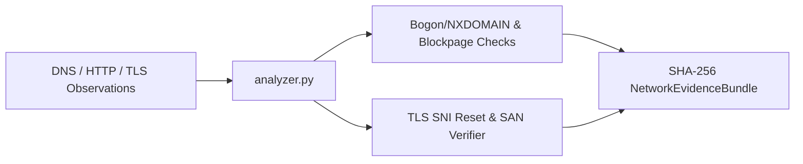

# netprobe-kit

[](https://github.com/codesphere-u/netprobe-kit/actions/workflows/ci.yml)
[](LICENSE)
[](pyproject.toml)
[](pyproject.toml)

**Offline-reproducible DNS tampering (bogon/sinkhole/false-NXDOMAIN), HTTP 451 blockpage & Wi-Fi captive-portal injection, and TLS SNI/MITM middlebox forensic evidence analyzer.**

- **Mission Domain:** Internet Infrastructure & Digital Rights
- **Stack:** Pure Python 3.11+ (zero runtime third-party dependencies, `mypy --strict`, `ruff`, `pytest`)
- **Maintainer:** Codesphere Innovations (U) Limited (`codesphere-u`)

---

## Problem Solved

Civil-society researchers, ISPs, and SREs need an embeddable, deterministic diagnostic library that distinguishes ISP DNS sinkholing, SNI DPI resets, and captive portals from ordinary origin outages with verifiable evidence.

## Key Features

- DNS local-vs-control comparison classifying RFC1918/loopback/unspecified bogon sinkholes (`DNS_BOGON_SINKHOLE`), forged NXDOMAINs (`DNS_FALSE_NXDOMAIN`), and low-TTL IP divergence.
- HTTP 451 / regulatory blockpage and Wi-Fi captive-portal hijack classification.
- TLS TCP-connected SNI DPI reset (`TLS_SNI_RESET`) vs MITM certificate SAN mismatch (`TLS_MITM_CERT_MISMATCH`) analyzer outputting SHA-256 `NetworkEvidenceBundle` records.

## Architecture Overview



See [docs/architecture.md](docs/architecture.md) for module-level design details.

## Installation

```bash
git clone https://github.com/codesphere-u/netprobe-kit.git
cd netprobe-kit
uv sync --extra dev
```

Or install in editable mode with standard `pip`:

```bash
pip install -e ".[dev]"
```

## Quick Start (CLI)

```bash
netprobe-kit demo
```

## Quick Start (Python API)

```python
from netprobe_kit import DnsObservation, build_evidence_bundle

b = build_evidence_bundle("p1", dns=[DnsObservation("news.example.org", ("127.0.0.1",), ("93.184.216.34",))])
assert b.interference_detected
```

## Testing & Quality Gates

```bash
uv run ruff check src tests
uv run mypy src
uv run pytest -v
```

## Security, Contributing & Roadmap

- **Security:** See [SECURITY.md](SECURITY.md) for responsible disclosure procedures.
- **Contributing:** See [CONTRIBUTING.md](CONTRIBUTING.md) and [CODE_OF_CONDUCT.md](CODE_OF_CONDUCT.md).
- **Changelog & Roadmap:** See [CHANGELOG.md](CHANGELOG.md) and [ROADMAP.md](ROADMAP.md).

## License

MIT License — see [LICENSE](LICENSE).

## Support & Contact

Open an issue on [GitHub Issues](https://github.com/codesphere-u/netprobe-kit/issues) or contact `codesphereinnovationz@gmail.com`.
